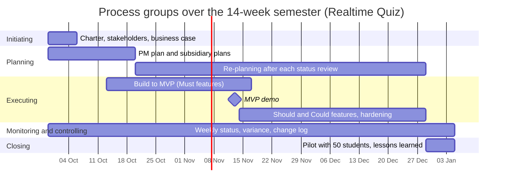

# Mapping Process Groups Across the Semester

## 1. Process Group Allocation

| Process group | Weeks active | Main activities | Outputs | Lab that produces them |
|---------------|--------------|-----------------|---------|------------------------|
| Initiating | 1 | Define project purpose, identify stakeholders, write business case, formalize project charter and obtain sponsor authorization | Project charter, stakeholder list (`stakeholders.csv`), business case (`business-case.md`/`csv`) | Lab-01 |
| Planning | 1-3 (burst), 4-13 (re-planning) | Deconstruct requirements, build WBS, estimate effort, schedule milestones, plan risk responses, specify quality metrics, and conduct rolling-wave re-planning after each review | Scope baseline, WBS dictionary, network diagram, Gantt schedule, risk register, quality management plan | Labs 02, 03, 04, 05, 06, 07, 08, 09, 10, 11 |
| Executing | 3-14 | Develop software across 10 build phases (auth, quiz authoring, live WebSockets, scoring, export), conduct code reviews, implement UI/UX, and deliver demo increments | Working software increments (Phases 1-10), MVP build (week 7), test suites, deployment configs | Lab-05, Lab-08, and ongoing development |
| Monitoring and controlling | 1-14 | Conduct weekly status standups, track schedule and budget variance (EVM), monitor CI test coverage, maintain risk log, and manage formal change requests | Weekly status reports, sprint burndown charts, change request log, updated baselines, issue log | Labs 05, 06, 09 (tools), and every lab (practice) |
| Closing | 14 | Execute live classroom pilot with 50 students, conduct operational handover to IT operations, archive artifacts, and document lessons learned | Pilot evaluation report, signed operational handover sign-off, final project report, lessons learned register | Lab-12 / Lab-14 |

## 2. Process groups over the semester

## 3. Phase gates

To safeguard the department's investment and uphold PRINCE2's core principle of **continued business justification**, the sponsor and project manager evaluate project viability at three critical phase gates:

1. **Gate 1: Charter Approval & Initiation Gate (Week 1)**
   - **Decision:** Authorize formal commencement of the project and release the 200 USD cash budget and 490-hour effort allocation.
   - **Required Evidence:** Signed [project-charter.md](project-charter.md), validated stakeholder register ([stakeholders.csv](stakeholders.csv)), and a financially sound business case ([business-case.md](business-case.md)) confirming a 1.1-year payback.
2. **Gate 2: Minimum Viable Product (MVP) Gate (Week 7)**
   - **Decision:** Continue into advanced Should/Could features or pivot to purchasing commercial SaaS (Option B) for the following semester.
   - **Required Evidence:** Live working demonstration of all core Must features (quiz authoring, real-time WebSocket session joining, synchronized question countdowns, instant scoring, and live leaderboards) with 0 blocking defects, automated line test coverage >= 80%, and a schedule variance within +/- 5 days.
3. **Gate 3: Pilot Readiness & Operations Gate (Week 13)**
   - **Decision:** Authorize live classroom deployment with 50 enrolled students and initiate operational transition to IT operations.
   - **Required Evidence:** Load test report demonstrating broadcast latency <= 500 ms at the 95th percentile under 100 concurrent simulated students, formal privacy clearance from the Data Protection Officer (S08), verified production `docker-compose.prod.yml`, and a validated operational runbook accepted by IT operations (S06).
