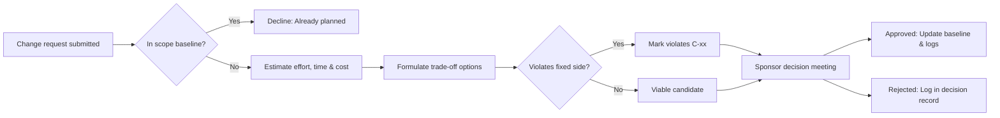

# Change requests · Realtime Quiz · trade-off analysis

Capacity 40 h/week · contingency 56 h · paid capacity 12 USD/h

## CR-01 · Add chat (F14, 40 h) to the Must scope · requested by sponsor

| Option | Time impact | Cost impact | Quality impact | Fixed side? |
| ------ | ----------- | ----------- | -------------- | ----------- |
| A slip the pilot | +1 week (40/40) | 0 USD | Pilot slips to week 15; grades missed | violates C-01 |
| B swap: defer F16 (30 h) + F15 (12 h) | +0 weeks | 0 USD | Must intact; no question bank, no guest login | ok |
| C pay: TA 40 h | +0 weeks | 40 x 12 = 480 USD | Must intact; budget deficit of 480 USD | violates C-03 |

**Recommendation:** Option B. Swapping out F16 Question bank (30 h) and F15 Anonymous joining (12 h) accommodates F14 (40 h) while protecting the week-14 pilot deadline and zero cash expenditure; Option A is rejected because slipping to week 15 violates the fixed date (C-01); Option C is rejected because 480 USD exceeds the 200 USD cash budget (C-03).

---

## CR-02 · Anonymous joining (F15, 12 h) · requested by students

| Option | Time impact | Cost impact | Quality impact | Fixed side? |
| ------ | ----------- | ----------- | -------------- | ----------- |
| A swap: defer F12 Notifications (12 h) | +0 weeks | 0 USD | Frictionless guest joining; alerts given verbally | ok |
| B absorb into contingency (56 -> 44 h) | +0 weeks | 0 USD | Preserves all scope; reduces risk buffer by 21.4 % | ok |
| C pay: TA 12 h | +0 weeks | 12 x 12 = 144 USD | Preserves scope and buffer; drains 72 % of cash | violates C-03 |

**Recommendation:** Option A. Swapping out F12 Real-time notifications (12 h) delivers anonymous guest access immediately without spending cash or compromising contingency; Option B is rejected because eroding contingency early jeopardizes Phase 8 performance hardening; Option C is rejected because paying 144 USD violates the cash ceiling (C-03).

---

## CR-03 · Semester shortened by 2 weeks: pilot in week 12 · dean

Capacity lost: 2 weeks x 40 h = 80 h; contingency shrinks 56 -> 48 h (10 % of 480 h).  
Planned work 504 h now exceeds capacity 480 h by 24 h before any risk.

| Option | Time impact | Cost impact | Quality impact | Fixed side? |
| ------ | ----------- | ----------- | -------------- | ----------- |
| A keep Should, drop Could (94 h: F14 40 + F15 12 + F16 30 + F17 12) | 0 weeks | 0 USD (saves 94 h; 70 h buffer) | Must intact; no chat, question bank, or admin UI | ok |
| B keep scope, pay TA 104 h | 0 weeks | 104 x 12 = 1248 USD | All 17 features kept; budget broken 6x | violates C-03 |
| C keep scope, pilot in week 14 | +2 weeks | 0 USD | All features kept; misses semester grading | violates new C-01 |

**Recommendation:** Option A. Dropping the 94 h of Could scope delivers all Must and Should features by week 12 while establishing a healthy 70 h buffer and requiring 0 USD; Option B is rejected because 1,248 USD violates the cash budget (C-03); Option C is rejected because missing the dean's week-12 deadline violates C-01.

---

## Process

