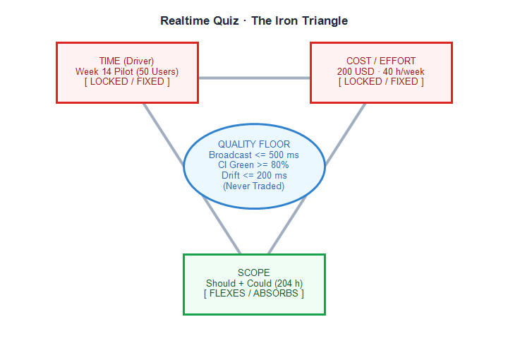

# Constraint analysis · Realtime Quiz · v0.1

| Constraint | Fixed or flexes | Evidence (quote, source) | If violated |
| ---------- | --------------- | ------------------------ | ----------- |
| Time | FIXED (driver) | "Go-live is a pilot with 50 students in week 14" (charter, Milestones); grades are due at semester end | No pilot = no capstone grade |
| Cost | FIXED | "4 students x 10 h/week; cash budget 200 USD" (charter, Budget) | Overspend has no approver; unpaid student hours capped |
| Scope | FLEXES | features.csv: 5 Should (110 h) + 4 Could (94 h) = 204 h of 504 h are negotiable | Should items move to Won't or post-pilot release |
| Quality | FIXED (floor) | "broadcast under 500 ms, WCAG AA, CI green" (charter, Objectives O3..O5 and DoD) | Pilot disrupted; assessment data corrupted or untrusted |
| Resources | FIXED | "4 students x 10 h/week = 40 h/week; PM 2 h/week" (charter, section Resources) | Team burnout, delivery failure, and course policy violation |
| Risk | FLEXES | "contingency 56 h (10 % of 560 h); cash reserve 85 USD" (charter, Budget) | Unbuffered variance exhausts delivery capacity and forces cuts |

## Project shape

Realtime Quiz is a fixed-date, fixed-budget project. The driver is the week-14 pilot deadline where 50 students and instructors must execute a live classroom quiz before semester grading closes. The second fixed side is the 200 USD cash budget and 40 h/week team capacity, while scope flexes to absorb surprises through the Should and Could classes (204 h, 40.5 % of planned effort).

## Quality floor (never traded)

1. WebSocket broadcast latency <= 500 ms at the 95th percentile under 100 simulated clients (charter O3).
2. Automated test line coverage >= 80 % with green CI status required on 100 % of pull requests before merging (charter O5).
3. Server timer drift <= 200 ms with capacity for 20 concurrent sessions on 2 vCPU and 2 GB RAM (charter O4).

