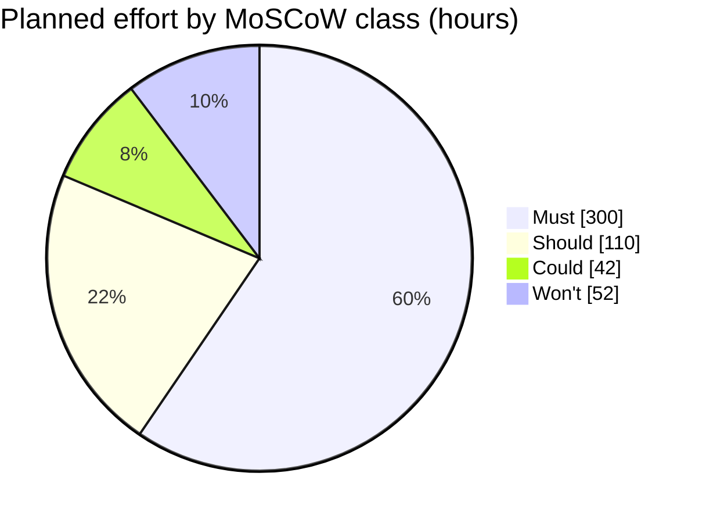

# MoSCoW rating for the week-14 pilot · Realtime Quiz

Test order: Must = pilot cancelled without it; Should = painful but a workaround exists; Could = nice to have, first to drop; Won't = explicitly not in this pilot.

| Id | Feature | Plan | Mine | h | Justification |
| --- | --------------------------------- | ------ | ------ | --- | ------------------------------------------------------------------------------------------------------ |
| F01 | Create quizzes with MCQ | Must | Must | 44 | Must: instructors cannot author question sets without it; pilot is cancelled without content creation. |
| F02 | Students participate in real time | Must | Must | 52 | Must: core student quiz-taking functionality; without live participation the pilot is cancelled. |
| F03 | Instant feedback and scoring | Must | Must | 28 | Must: students must see score calculations immediately after submission; pilot cancelled without it. |
| F04 | Leaderboards | Must | Must | 24 | Must: core competitive gamification mechanism; without ranking display the pilot is cancelled. |
| F05 | Real-time updates over WebSocket | Must | Must | 48 | Must: underlying protocol for live state broadcast; without WebSocket the pilot cannot run. |
| F06 | Authentication and roles | Must | Must | 44 | Must: separates instructor quiz controls from student test takers; pilot is cancelled without access control. |
| F07 | Timer per question | Must | Must | 28 | Must: enforces synchronized pacing across all 50 participants; pilot is cancelled without timing control. |
| F08 | Multiple concurrent sessions | Must | Must | 32 | Must: required to isolate concurrent section rooms during pilot week; pilot cancelled if sessions collide. |
| F09 | Responsive design | Should | Should | 20 | Should: painful on varied mobile screens, but students can use laptops or zoom UI for one pilot. Workaround exists. |
| F10 | Analytics and reporting | Should | Should | 30 | Should: painful for instructors after the quiz, but summary marks can be inspected directly in the DB. Workaround exists. |
| F11 | Export results to CSV and PDF | Should | Should | 24 | Should: instructors can copy tabular results into a spreadsheet; PDF export is cosmetic for a pilot. Workaround exists. |
| F12 | Real-time notifications | Should | Should | 12 | Should: painful if start cues are missed, but the instructor provides verbal instructions in class. Workaround exists. |
| F13 | Multimedia in questions | Should | Should | 24 | Should: painful to omit diagrams, but instructors agreed to pilot with text-only multiple choice. Workaround exists. |
| F14 | Chat during sessions | Could | Won't | 40 | Won't: live chat introduces moderation liability and distraction; explicitly excluded from this pilot. |
| F15 | Anonymous joining with nickname | Could | Could | 12 | Could: convenient for guest access, but pre-created student accounts satisfy pilot authentication. First to drop. |
| F16 | Question bank shared between quizzes | Could | Could | 30 | Could: helpful to reuse items across quizzes, but instructors can re-enter questions manually for one pilot. First to drop. |
| F17 | Admin role and user management | Could | Won't | 12 | Won't: dedicated admin UI is unnecessary for 50 users; PM manages accounts by SQL seed script for this pilot. |

## Totals

| Class | Features | Hours | Share of 504 h |
| ------ | -------- | ----- | -------------- |
| Must | 8 | 300 | 59.5 % |
| Should | 5 | 110 | 21.8 % |
| Could | 2 | 42 | 8.3 % |
| Won't | 2 | 52 | 10.3 % |
| **Total** | **17** | **504** | **100.0 %** |

Must share = 300 h / 504 h x 100 = 59.5 % (guideline: 60 % or less)

